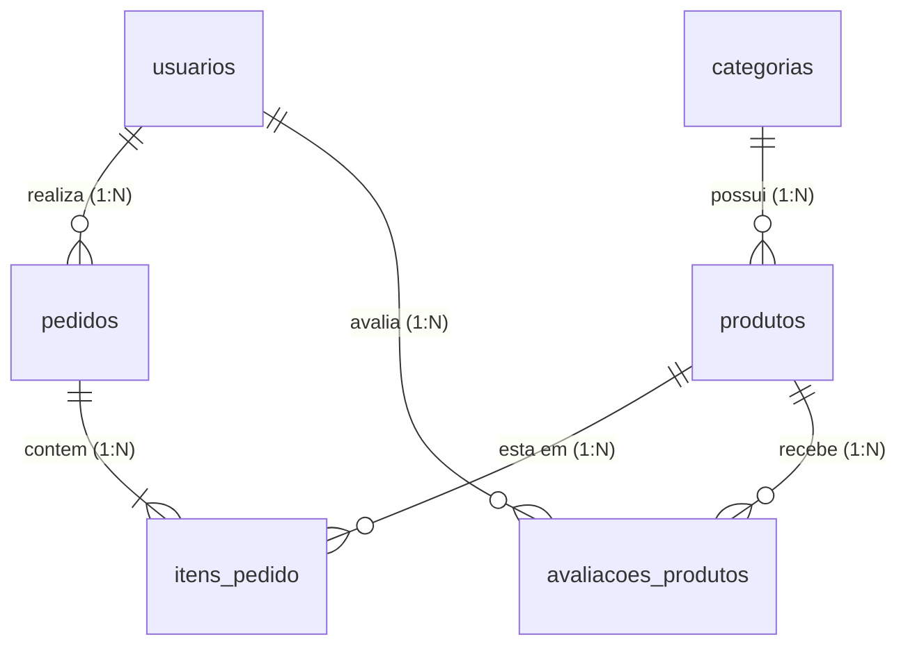

# Conecta+ - Banco de Dados Relacional MySQL (TCC)

Este projeto conta com um modelo relacional completo de **6 tabelas conectadas** por Chaves Primárias (PK) e Chaves Estrangeiras (FK), modelado para atender aos requisitos de apresentação do TCC.

---

## 🗂️ Modelo de Dados (6 Tabelas Conectadas)

As 6 tabelas cobrem todo o ciclo de usuários, categorias, catálogo de produtos, pedidos, itens de compras e avaliações:

1. **`usuarios`** (Cadastro de Usuários, Alunos e Administradores)
   - Armazena dados cadastrais, autenticação (e-mail/senha) e tipo de acesso (`usuario` ou `admin`).

2. **`categorias`** (Categorização do Catálogo)
   - Categorias dos produtos, cursos e materiais (ex: Tecnologia Assistiva, Cursos, Libras).

3. **`produtos`** (Catálogo de Produtos, Cursos e Recursos)
   - Conectada à tabela `categorias` via chave estrangeira `categoria_id` (Relação 1:N).

4. **`pedidos`** (Registro de Compras e Solicitações)
   - Conectada à tabela `usuarios` via chave estrangeira `usuario_id` (Relação 1:N).

5. **`itens_pedido`** (Tabela Associativa N:N - Conexão Pedidos e Produtos)
   - Conecta a tabela `pedidos` (`pedido_id`) com a tabela `produtos` (`produto_id`). Cada pedido pode conter vários produtos e um produto pode estar em vários pedidos.

6. **`avaliacoes_produtos`** (Feedback dos Usuários)
   - Conecta `usuarios` (`usuario_id`) e `produtos` (`produto_id`), permitindo notas de 1 a 5 estrelas e comentários.

---

### 📊 Diagrama Entidade-Relacionamento (DER)



---

## 🚀 Como Criar o Banco e as 6 Tabelas

1. Abra o **MySQL Workbench**, **phpMyAdmin** (XAMPP/Wamp) ou o terminal MySQL.
2. Abra e execute o arquivo [`database.sql`](file:///c:/Users/aluno/Documents/estefany/clone/TCC/database.sql).
3. O script cria o banco `conecta_plus`, as 6 tabelas com chaves estrangeiras e insere dados reais de teste prontos para apresentação.

### Testar a Conexão no Terminal
Você pode verificar se as 6 tabelas foram criadas com o comando:
```bash
node testar-mysql.js
```

---

## 🔍 Consultas SQL com JOIN (Ideais para apresentação do TCC)

### 1. Produtos com o nome da Categoria:
```sql
SELECT 
  p.nome AS produto,
  c.nome AS categoria,
  p.preco,
  p.estoque
FROM produtos p
INNER JOIN categorias c ON p.categoria_id = c.id;
```

### 2. Pedidos com Dados do Usuário Comprador:
```sql
SELECT 
  ped.id AS numero_pedido,
  u.nome AS cliente,
  u.email,
  ped.data_pedido,
  ped.status,
  ped.valor_total
FROM pedidos ped
INNER JOIN usuarios u ON ped.usuario_id = u.id;
```

### 3. Detalhes Completos dos Itens do Pedido (Conexão N:N):
```sql
SELECT 
  ped.id AS pedido_id,
  u.nome AS cliente,
  prod.nome AS produto_comprado,
  item.quantidade,
  item.preco_unitario,
  item.subtotal
FROM itens_pedido item
INNER JOIN pedidos ped ON item.pedido_id = ped.id
INNER JOIN usuarios u ON ped.usuario_id = u.id
INNER JOIN produtos prod ON item.produto_id = prod.id;
```

### 4. Média de Avaliações por Produto:
```sql
SELECT 
  p.nome AS produto,
  ROUND(AVG(a.nota), 1) AS media_estrelas,
  COUNT(a.id) AS total_avaliacoes
FROM produtos p
LEFT JOIN avaliacoes_produtos a ON p.id = a.produto_id
GROUP BY p.id, p.nome;
```

---

## ⚙️ Rotas Disponíveis no Backend (`server.js`)

- `POST /api/cadastro` - Cadastro de usuário no MySQL
- `POST /api/login` - Autenticação com identificação de tipo (`usuario` ou `admin`)
- `GET /api/usuarios` - Lista todos os usuários
- `DELETE /api/usuarios/:id` - Exclui um usuário (Painel Admin)
- `GET /api/admin/stats` - Estatísticas para o painel administrativo
- `GET /api/produtos` - Lista todos os produtos com nome da categoria
- `GET /api/categorias` - Lista todas as categorias ativas
- `GET /api/pedidos` - Lista todos os pedidos com dados do cliente
